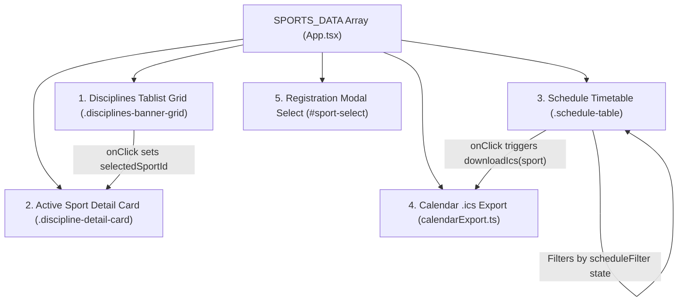
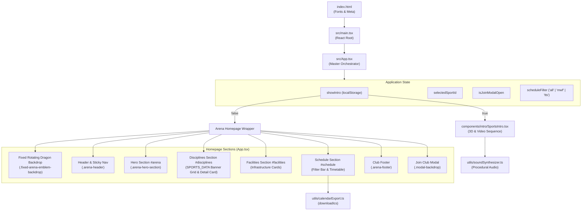

# IGNITE SPORTS CLUB — Architecture & Contributor Component Guide

Welcome to the **IGNITE SPORTS CLUB — EST. 2026** contributor architecture and component guide. This document serves as the single source of truth for the project's architectural patterns, design token definitions, button components, and step-by-step instructions for extending application features such as sports disciplines.

---

## Table of Contents

1. [Architectural Overview](#1-architectural-overview)
2. [Project Directory Structure](#2-project-directory-structure)
3. [Design Tokens Reference](#3-design-tokens-reference)
   - [Background Color Tokens](#background-color-tokens)
   - [Brand & Accent Color Tokens](#brand--accent-color-tokens)
   - [Text & Content Color Tokens](#text--content-color-tokens)
   - [Accent Glow & Shadow Tokens](#accent-glow--shadow-tokens)
   - [Typography Tokens](#typography-tokens)
   - [Geometric Chamfer Cut Tokens (Clip-Paths)](#geometric-chamfer-cut-tokens-clip-paths)
   - [Layout & Elevation Conventions](#layout--elevation-conventions)
4. [Button Styles & Component Documentation](#4-button-styles--component-documentation)
   - [The Cyber-Cut Button (`.sports-cut-button`)](#the-cyber-cut-button-sports-cut-button)
   - [Primary Variant (`.sports-cut-button.primary`)](#primary-variant-sports-cut-buttonprimary)
   - [Secondary Variant (`.sports-cut-button.secondary`)](#secondary-variant-sports-cut-buttonsecondary)
   - [Contextual Modifiers & Sizing](#contextual-modifiers--sizing)
   - [Additional Button Elements in the Application](#additional-button-elements-in-the-application)
5. [Extending Sports Cards & the `SPORTS_DATA` Array](#5-extending-sports-cards--the-sports_data-array)
   - [Where `SPORTS_DATA` is Defined](#where-sports_data-is-defined)
   - [The `SportCategory` Interface](#the-sportcategory-interface)
   - [Detailed Property Specifications](#detailed-property-specifications)
   - [How `SPORTS_DATA` Renders Across the Application](#how-sports_data-renders-across-the-application)
   - [Step-by-Step Guide: Adding a New Sport Discipline](#step-by-step-guide-adding-a-new-sport-discipline)
   - [Full Working Example](#full-working-example)
6. [Component Relationships & Application Flow](#6-component-relationships--application-flow)
7. [Accessibility & Motion Guidelines](#7-accessibility--motion-guidelines)
8. [Contributor Verification Checklist](#8-contributor-verification-checklist)

---

## 1. Architectural Overview

**IGNITE SPORTS CLUB — EST. 2026** is a high-performance web platform built with a modern React, TypeScript, and Vite stack. It combines realistic athletic media, procedural Web Audio synthesizer soundscapes, 3D WebGL scenes, and an interactive collegiate sports arena portal.

### Core Technology Stack

- **UI Framework**: [React 19](https://react.dev/) (`react`, `react-dom`)
- **Language**: [TypeScript](https://www.typescriptlang.org/) (strict type-checking via `tsc -b`)
- **Bundler & Dev Server**: [Vite 8](https://vitejs.dev/) with Hot Module Replacement (HMR)
- **Styling**: Pure **Vanilla CSS** with global CSS custom properties (design tokens in `src/index.css`) and modular stylesheets (`src/App.css`, component-level stylesheets in `src/components/intro/`). *No CSS frameworks or Tailwind utility classes are used.*
- **Icons**: [Lucide React](https://lucide.dev/) (`lucide-react`)
- **3D Graphics & Animations**: [Three.js](https://threejs.org/), [@react-three/fiber](https://r3f.docs.pmnd.rs/), [@react-three/drei](https://github.com/pmndrs/drei), and [GSAP](https://gsap.com/)
- **Audio Engine**: 100% procedural Web Audio API synthesis in [`src/utils/soundSynthesizer.ts`](file:///Users/lokeshkumarsahu/Desktop/OPEN-SOURCE/ignite-sports-club/src/utils/soundSynthesizer.ts) (zero external audio file dependencies)
- **Code Quality**: [Oxlint](https://oxc.rs/)

### Architectural Principles

1. **Tokenized Design System**: All colors, font families, and atmospheric glows are defined in `:root` in [`src/index.css`](file:///Users/lokeshkumarsahu/Desktop/OPEN-SOURCE/ignite-sports-club/src/index.css). Components consume these tokens directly to maintain brand consistency.
2. **Dual-State Application Orchestration**: The root component [`src/App.tsx`](file:///Users/lokeshkumarsahu/Desktop/OPEN-SOURCE/ignite-sports-club/src/App.tsx) coordinates between:
   - **Cinematic 3D Intro Experience** (`<SportsIntro />`): Interactive multi-scene video sequence, Web Audio soundtrack, and logo reveal.
   - **Full Arena Homepage** (`<main className="arena-homepage-wrapper">`): The primary portal featuring hero banner, interactive disciplines selector, facilities showcase, weekly schedule with live `.ics` calendar export, and tryout registration modal.
3. **Decoupled Data Architecture**: Sports program information is centralized in the typed `SPORTS_DATA` array in [`src/App.tsx`](file:///Users/lokeshkumarsahu/Desktop/OPEN-SOURCE/ignite-sports-club/src/App.tsx), which feeds multiple independent UI features (the interactive banner grid, the active program detail view, the schedule table, day filters, and the calendar file exporter).
4. **Accessible, Responsive, & Motion-Sensitive**: Semantic HTML5 elements (`<header>`, `<nav>`, `<main>`, `<section>`, `<footer>`, `<table>`), ARIA roles (`tablist`, `tab`, `dialog`), and `@media (prefers-reduced-motion: reduce)` fallbacks are strictly maintained.

---

## 2. Project Directory Structure

```text
ignite-sports-club/
├── .github/                         # GitHub templates, CI workflows & issue taxonomies
│   ├── ISSUE_TEMPLATE/              # Bug report and feature request templates
│   ├── workflows/
│   │   └── ci.yml                   # CI pipeline running Oxlint and build checks
│   ├── LABELS_AND_INITIAL_ISSUES.md # Label definitions and project roadmap
│   ├── PULL_REQUEST_TEMPLATE.md     # Pull request checklist
│   └── code-reviewer.md             # Automated review guidance
├── docs/                            # Contributor and architecture documentation
│   └── architecture.md              # Architecture, design token & component guide (this document)
├── public/                          # Static assets served directly at the root URL
│   ├── favicon.svg                  # Brand favicon
│   ├── icons.svg                    # SVG icon definitions
│   ├── ignite-dragon-emblem.png     # Official high-resolution transparent dragon crest
│   ├── ignite-logo.jpg              # Official club artwork
│   └── videos/                      # Realistic sports footage clips (Scenes 2-5)
├── src/                             # Application source code
│   ├── assets/                      # Bundled static assets referenced in code
│   │   ├── hero.png                 # Hero background graphic
│   │   ├── ignite-dragon-emblem.png # Dragon emblem asset
│   │   └── ignite-logo.jpg          # Emblem artwork
│   ├── components/
│   │   └── intro/                   # 3D cinematic intro sequences & WebGL models
│   │       ├── Athlete3D.tsx        # 3D athlete visualizer
│   │       ├── BasketballModel.tsx  # 3D Basketball model
│   │       ├── CentralEnergyCore.tsx# Energy core animation
│   │       ├── CinematicFootballScene.tsx # Football cinematic backdrop
│   │       ├── CinematicVideoScene.tsx   # Realistic sports video scene runner
│   │       ├── ClubCrest.tsx        # Final crest reveal overlay
│   │       ├── CricketBallModel.tsx # 3D Cricket ball model
│   │       ├── FireTransitionOverlay.tsx # Cosmic fire vortex scene
│   │       ├── FootballModel.tsx    # 3D Football model
│   │       ├── FuturisticTunnel.tsx # 3D warp tunnel
│   │       ├── IntroControls.tsx    # HUD sound toggle, skip, and replay controls
│   │       ├── OriginalLogoReveal.tsx # Logo reveal transition
│   │       ├── ShuttlecockModel.tsx # 3D Badminton shuttlecock model
│   │       ├── SportsIntro.tsx      # Master intro orchestrator
│   │       ├── SportsMontageScene.tsx # Montage sequencer
│   │       ├── SportsScene.tsx      # Three.js canvas container
│   │       └── TapToEnter.tsx       # Scene 1: Tap to Enter interaction
│   ├── utils/                       # Standalone utility modules
│   │   ├── calendarExport.ts        # RFC 5545 iCalendar (.ics) generation & download
│   │   ├── proceduralTextures.ts    # Dynamic HTML5 canvas texture generators
│   │   └── soundSynthesizer.ts      # Web Audio API procedural music and SFX engine
│   ├── App.css                      # Arena homepage styling, layouts, modal, and responsive rules
│   ├── App.tsx                      # Main application orchestrator & SPORTS_DATA data store
│   ├── index.css                    # Design tokens (:root), resets, button classes & typography
│   └── main.tsx                     # React application entry point (ReactDOM.createRoot)
├── .env.example                     # Environment configuration template
├── .gitignore                       # Git exclusions (node_modules, dist, secrets)
├── .oxlintrc.json                   # Oxlint rules configuration
├── CONTRIBUTING.md                  # Contributor workflow and PR guidelines
├── CODE_OF_CONDUCT.md               # Community standards
├── index.html                       # HTML shell loading Google Fonts and mounting #root
├── LICENSE                          # MIT open-source license
├── package.json                     # NPM dependencies, scripts, and project metadata
├── README.md                        # Project overview and quickstart guide
├── tsconfig.json                    # Root TypeScript configuration
├── tsconfig.app.json                # TypeScript compiler options for application source
├── tsconfig.node.json               # TypeScript compiler options for Vite tooling
└── vite.config.ts                   # Vite configuration with React plugin
```

---

## 3. Design Tokens Reference

All official design tokens are declared as CSS custom properties in the `:root` pseudo-class in [`src/index.css`](file:///Users/lokeshkumarsahu/Desktop/OPEN-SOURCE/ignite-sports-club/src/index.css). Contributors must always use these variables rather than hardcoding hexadecimal values or arbitrary RGB strings.

### Background Color Tokens

These tokens establish the dark, futuristic athletic stadium aesthetic:

| CSS Variable | Value | Visual Swatch | Description & Purpose |
| :--- | :--- | :---: | :--- |
| `--bg-midnight` | `#080B18` | <span style="display:inline-block;width:18px;height:18px;background-color:#080B18;border:1px solid #444;border-radius:3px;vertical-align:middle;"></span> | **Midnight Black**: The deepest canvas background for `html`, `body`, `#root`, and the homepage root. |
| `--bg-navy` | `#101B3D` | <span style="display:inline-block;width:18px;height:18px;background-color:#101B3D;border:1px solid #444;border-radius:3px;vertical-align:middle;"></span> | **Deep Navy**: Primary container surface used for the active sport detail card (`.discipline-detail-card`) and table headers. |
| `--bg-navy-elevated` | `#16244F` | <span style="display:inline-block;width:18px;height:18px;background-color:#16244F;border:1px solid #444;border-radius:3px;vertical-align:middle;"></span> | **Elevated Navy**: Used for raised surface panels, nested cards, and hover elevation states. |
| `--bg-card` | `rgba(16, 27, 61, 0.88)` | <span style="display:inline-block;width:18px;height:18px;background-color:rgba(16,27,61,0.88);border:1px solid #444;border-radius:3px;vertical-align:middle;"></span> | **Card Surface**: Semi-transparent navy backdrop for discipline cards, facility cards, and schedule containers. |
| `--bg-card-border` | `rgba(40, 123, 255, 0.28)` | <span style="display:inline-block;width:18px;height:18px;background-color:rgba(40,123,255,0.28);border:1px solid #444;border-radius:3px;vertical-align:middle;"></span> | **Card Border**: Subtle electric blue border delineating interactive cards and containers against the midnight canvas. |

### Brand & Accent Color Tokens

These tokens define the signature IGNITE energy palette (Electric Blue and Cosmic Purple):

| CSS Variable | Value | Visual Swatch | Description & Purpose |
| :--- | :--- | :---: | :--- |
| `--color-primary-blue` | `#287BFF` | <span style="display:inline-block;width:18px;height:18px;background-color:#287BFF;border:1px solid #444;border-radius:3px;vertical-align:middle;"></span> | **Electric Blue**: Primary brand color. Used for active navigation indicators, primary button gradients, card highlights, and focus rings. |
| `--color-cosmic-purple` | `#8B5CF6` | <span style="display:inline-block;width:18px;height:18px;background-color:#8B5CF6;border:1px solid #444;border-radius:3px;vertical-align:middle;"></span> | **Cosmic Purple**: Secondary brand accent. Forms the second stop of the primary button gradient, energy core lighting, and selected tab indicator lines. |
| `--color-ice-blue` | `#62C7FF` | <span style="display:inline-block;width:18px;height:18px;background-color:#62C7FF;border:1px solid #444;border-radius:3px;vertical-align:middle;"></span> | **Ice Blue**: High-contrast athletic HUD color. Used for telemetry labels, section kickers, status pills, live indicators, secondary button text, and icon accents. |

### Text & Content Color Tokens

These tokens ensure optimal legibility across dark surfaces meeting WCAG contrast benchmarks:

| CSS Variable | Value | Visual Swatch | Description & Purpose |
| :--- | :--- | :---: | :--- |
| `--text-primary` | `#FFFFFF` | <span style="display:inline-block;width:18px;height:18px;background-color:#FFFFFF;border:1px solid #444;border-radius:3px;vertical-align:middle;"></span> | **Pure White**: Primary headings (`h1`, `h2`, `h3`), hero display text, active link labels, and high-emphasis values. |
| `--text-secondary` | `#B7C0D8` | <span style="display:inline-block;width:18px;height:18px;background-color:#B7C0D8;border:1px solid #444;border-radius:3px;vertical-align:middle;"></span> | **Muted Silver-Blue**: Body copy, section descriptions, facility card paragraphs, and secondary metadata. |
| `--text-muted` | `#8E9AB8` | <span style="display:inline-block;width:18px;height:18px;background-color:#8E9AB8;border:1px solid #444;border-radius:3px;vertical-align:middle;"></span> | **Deep Slate**: Footer copyright text, low-emphasis notices, and placeholder captions. |

### Accent Glow & Shadow Tokens

These tokens power the atmospheric lighting effects across buttons, hero elements, and borders:

| CSS Variable | Value | Purpose & Application |
| :--- | :--- | :--- |
| `--accent-glow-blue` | `0 0 25px rgba(40, 123, 255, 0.55)` | Medium electric blue glow applied to primary buttons and selected elements on hover. |
| `--accent-glow-purple` | `0 0 25px rgba(139, 92, 246, 0.55)` | Cosmic purple atmospheric back-glow used in multi-layer hover transitions. |
| `--accent-glow-ice` | `0 0 20px rgba(98, 199, 255, 0.6)` | Ice-blue radiance used for active telemetry tags and live status indicators. |
| `--accent-glow-strong` | `0 0 50px rgba(40, 123, 255, 0.8)` | High-intensity aura used for focal moments and prominent button activations. |

### Typography Tokens

Imported via Google Fonts in [`index.html`](file:///Users/lokeshkumarsahu/Desktop/OPEN-SOURCE/ignite-sports-club/index.html):

| CSS Variable | Font Family Value | Usage Guidelines |
| :--- | :--- | :--- |
| `--font-display` | `'Syne', sans-serif` | High-impact geometric display font. Used for prominent promotional typography. |
| `--font-athletic` | `'Chakra Petch', 'Outfit', sans-serif` | The core **athletic cyber font**. Features uppercase styling, wide letter-spacing (`0.12em` to `0.24em`), and sharp angular glyphs. Used on `.sports-cut-button`, `.section-kicker`, titles, brand crest typography, tags, and table headers. |
| `--font-sans` | `'Outfit', sans-serif` | Crisp, modern grotesque sans-serif. Applied globally to `html, body` for high-legibility body paragraphs, form inputs, and descriptive text. |

### Geometric Chamfer Cut Tokens (Clip-Paths)

A signature element of the IGNITE Sports Club visual identity is the **cyber-cut chamfered corner**. Rather than standard rounded borders, interactive cards and buttons use CSS `clip-path: polygon(...)` to slice opposing or all corners at 45-degree angles:

| Element | Clip-Path Value | Effect |
| :--- | :--- | :--- |
| `.sports-cut-button` | `polygon(14px 0, 100% 0, 100% calc(100% - 14px), calc(100% - 14px) 100%, 0 100%, 0 14px)` | Diagonal cut on top-left and bottom-right corners (14px). |
| `.discipline-item` | `polygon(14px 0, 100% 0, 100% calc(100% - 14px), calc(100% - 14px) 100%, 0 100%, 0 14px)` | Diagonal cut matching button chamfers for cohesive grid rhythm. |
| `.discipline-detail-card` | `polygon(14px 0, 100% 0, 100% calc(100% - 14px), calc(100% - 14px) 100%, 0 100%, 0 14px)` | Large-format chamfer framing the active discipline view. |
| `.facility-card` | `polygon(12px 0, 100% 0, 100% calc(100% - 12px), calc(100% - 12px) 100%, 0 100%, 0 12px)` | Subtle 12px diagonal cut for campus venue cards. |
| `.modal-card` | `polygon(14px 0, 100% 0, 100% calc(100% - 14px), calc(100% - 14px) 100%, 0 100%, 0 14px)` | Chamfered dialog container for tryout registration. |
| `.table-join-btn` | `polygon(6px 0, 100% 0, 100% calc(100% - 6px), calc(100% - 6px) 100%, 0 100%, 0 6px)` | Compact 6px diagonal cut for table action buttons. |

### Layout & Elevation Conventions

- **Page Shell**: Full width with `min-height: 100vh`, `overflow-x: hidden`, and fixed backdrop emblem.
- **Maximum Container Widths**:
  - Top Navigation (`.arena-header`): `max-width: 1400px; margin: 0 auto;`
  - Disciplines, Facilities, Schedule, Footer: `max-width: 1280px; margin: 0 auto;`
  - Hero Banner (`.arena-hero-section`): `max-width: 1200px; margin: 0 auto;`
  - Registration Modal (`.modal-card`): `max-width: 540px;`
- **Standard Transition Timing**: `transition: all 0.28s cubic-bezier(0.16, 1, 0.3, 1);` providing smooth, snappy kinetic responses.
- **Responsive Breakpoint**: `@media (max-width: 820px)` shifts the desktop navigation into a mobile slide-down drawer, converts card grids to single-column, and stacks form input rows.

---

## 4. Button Styles & Component Documentation

Button components in the IGNITE platform are designed to look like high-tech athletic equipment controls. They are implemented in [`src/index.css`](file:///Users/lokeshkumarsahu/Desktop/OPEN-SOURCE/ignite-sports-club/src/index.css) as reusable global utility classes.

### The Cyber-Cut Button (`.sports-cut-button`)

The `.sports-cut-button` class is the primary button component across the entire application. It combines athletic typography, chamfered corner geometry, and kinetic micro-interactions.

#### Base CSS Implementation ([`src/index.css:61-77`](file:///Users/lokeshkumarsahu/Desktop/OPEN-SOURCE/ignite-sports-club/src/index.css#L61-L77))

```css
.sports-cut-button {
  position: relative;
  font-family: var(--font-athletic);
  text-transform: uppercase;
  font-weight: 700;
  letter-spacing: 0.12em;
  padding: 14px 34px;
  border: none;
  cursor: pointer;
  transition: all 0.28s cubic-bezier(0.16, 1, 0.3, 1);
  clip-path: polygon(14px 0, 100% 0, 100% calc(100% - 14px), calc(100% - 14px) 100%, 0 100%, 0 14px);
  user-select: none;
  display: inline-flex;
  align-items: center;
  justify-content: center;
  gap: 10px;
}
```

### Primary Variant (`.sports-cut-button.primary`)

Used for primary calls-to-action such as **"JOIN CLUB"**, **"EXPLORE EVENTS"**, **"REGISTER FOR SPORT"**, and form submission.

#### CSS Properties & Hover States ([`src/index.css:79-93`](file:///Users/lokeshkumarsahu/Desktop/OPEN-SOURCE/ignite-sports-club/src/index.css#L79-L93))

```css
.sports-cut-button.primary {
  background: linear-gradient(135deg, var(--color-primary-blue) 0%, var(--color-cosmic-purple) 100%);
  color: #ffffff;
  box-shadow: 0 4px 22px rgba(40, 123, 255, 0.45);
}

.sports-cut-button.primary:hover {
  transform: translateY(-2px) scale(1.02);
  box-shadow: 0 6px 32px rgba(40, 123, 255, 0.7), 0 0 20px rgba(139, 92, 246, 0.4);
  filter: brightness(1.12);
}

.sports-cut-button.primary:active {
  transform: translateY(1px) scale(0.99);
}
```

- **Visual Appearance**: Energetic 135-degree gradient from Electric Blue to Cosmic Purple with crisp white typography.
- **Hover Micro-interaction**: Elevates upward by `2px`, slightly scales (`1.02`), intensifies outer electric blue glow, and increases brightness by `12%`.
- **Active / Press**: Tactile compression downward by `1px` and `0.99` scale.

#### JSX Usage Example

```tsx
import { ArrowRight } from 'lucide-react';

<button type="button" className="sports-cut-button primary" onClick={handleAction}>
  <span>EXPLORE EVENTS</span>
  <ArrowRight size={18} />
</button>
```

### Secondary Variant (`.sports-cut-button.secondary`)

Used for alternative actions, such as **"JOIN US"** in the hero section, **"REPLAY INTRO"** in the navigation header, and **"SKIP INTRO"** during the intro sequence.

#### CSS Properties & Hover States ([`src/index.css:95-108`](file:///Users/lokeshkumarsahu/Desktop/OPEN-SOURCE/ignite-sports-club/src/index.css#L95-L108))

```css
.sports-cut-button.secondary {
  background: rgba(16, 27, 61, 0.85);
  color: var(--color-ice-blue);
  border: 1px solid rgba(40, 123, 255, 0.45);
  backdrop-filter: blur(8px);
}

.sports-cut-button.secondary:hover {
  background: rgba(40, 123, 255, 0.16);
  border-color: var(--color-ice-blue);
  color: #ffffff;
  box-shadow: 0 0 22px rgba(40, 123, 255, 0.35);
  transform: translateY(-2px);
}
```

- **Visual Appearance**: Semi-transparent Navy card surface with a glassmorphism blur (`8px`), subtle Electric Blue boundary border, and high-visibility Ice Blue typography.
- **Hover Micro-interaction**: Shifts background to a luminous Electric Blue wash, turns text pure white, illuminates border to Ice Blue, and applies a `22px` cyan glow.

#### JSX Usage Example

```tsx
import { Play } from 'lucide-react';

<button type="button" className="sports-cut-button secondary" onClick={handleReplay}>
  <Play size={14} />
  <span>REPLAY INTRO</span>
</button>
```

### Contextual Modifiers & Sizing

The following contextual classes override padding or sizing for specific layout requirements:

| Modifier Class | Context / Location | Rule Overrides |
| :--- | :--- | :--- |
| `.replay-intro-nav-btn` | Navigation Bar ([`src/App.css:161`](file:///Users/lokeshkumarsahu/Desktop/OPEN-SOURCE/ignite-sports-club/src/App.css#L161)) | `padding: 10px 18px; font-size: 0.8rem;` |
| `.register-interest-btn` | Discipline Detail Header ([`src/App.tsx:479`](file:///Users/lokeshkumarsahu/Desktop/OPEN-SOURCE/ignite-sports-club/src/App.tsx#L479)) | Uses standard `.primary` styling aligned horizontally with the active sport title. |
| `.submit-reg-btn` | Join Modal Form ([`src/App.css:1132`](file:///Users/lokeshkumarsahu/Desktop/OPEN-SOURCE/ignite-sports-club/src/App.css#L1132)) | `margin-top: 10px; width: 100%;` (full container width). |
| Mobile Stack Overrides | Intro & Drawer ([`src/components/intro/ClubCrest.css:226`](file:///Users/lokeshkumarsahu/Desktop/OPEN-SOURCE/ignite-sports-club/src/components/intro/ClubCrest.css#L226)) | At screen widths `<= 600px`, `.sports-cut-button` expands to `width: 100%`. |

### Additional Button Elements in the Application

Beyond `.sports-cut-button`, the platform implements several specialized buttons:

1. **`.table-join-btn`** ([`src/App.css:950`](file:///Users/lokeshkumarsahu/Desktop/OPEN-SOURCE/ignite-sports-club/src/App.css#L950)):
   - **Purpose**: Compact call-to-action button inside each schedule timetable row.
   - **Styling**: `padding: 8px 16px`, transparent background, `border: 1px solid rgba(40, 123, 255, 0.45)`, `color: var(--color-ice-blue)`.
   - **Chamfer**: Micro 6px diagonal cut (`clip-path: polygon(6px 0, 100% 0, 100% calc(100% - 6px), calc(100% - 6px) 100%, 0 100%, 0 6px)`).
   - **Hover**: Fills with `var(--color-primary-blue)` with white text and `16px` glow.

2. **`.table-calendar-btn`** ([`src/App.css:921`](file:///Users/lokeshkumarsahu/Desktop/OPEN-SOURCE/ignite-sports-club/src/App.css#L921)):
   - **Purpose**: Triggers direct download of RFC 5545 `.ics` iCalendar event for recurring training sessions.
   - **Styling**: Minimalist glass button with inline `Calendar` icon from `lucide-react`.

3. **`.schedule-filter-btn`** ([`src/App.css:888`](file:///Users/lokeshkumarsahu/Desktop/OPEN-SOURCE/ignite-sports-club/src/App.css#L888)):
   - **Purpose**: Filter pills for **"All Schedules"**, **"Mon/Wed/Fri"**, and **"Tue/Thu/Sat"**.
   - **Styling**: Semi-transparent navy button. When active (`.schedule-filter-btn.active`), receives `background: var(--color-primary-blue)` and an electric glow.

4. **`.discipline-item`** ([`src/App.css:528`](file:///Users/lokeshkumarsahu/Desktop/OPEN-SOURCE/ignite-sports-club/src/App.css#L528)):
   - **Purpose**: Semantic `<button>` acting as an interactive tab inside `role="tablist"` in the disciplines section.
   - **Styling**: 14px chamfer cut, top indicator bar (`::before`), hover lift (`translateY(-3px)`), and glowing border when selected (`.discipline-item.is-selected`).

5. **`.nav-link`** ([`src/App.css:119`](file:///Users/lokeshkumarsahu/Desktop/OPEN-SOURCE/ignite-sports-club/src/App.css#L119)):
   - **Purpose**: Header navigation links (`ARENA`, `DISCIPLINES`, `FACILITIES`, `SCHEDULE`).
   - **Styling**: Athletic uppercase typography with an expanding animated electric blue bottom border (`::after`).

6. **`.modal-close-btn`** ([`src/App.css:1055`](file:///Users/lokeshkumarsahu/Desktop/OPEN-SOURCE/ignite-sports-club/src/App.css#L1055)):
   - **Purpose**: Closes the registration dialog. Features hover transition from silver to ice-blue.

---

## 5. Extending Sports Cards & the `SPORTS_DATA` Array

The entire sports catalogue displayed across the homepage is driven by the typed `SPORTS_DATA` array. When contributors want to introduce a new athletic discipline (e.g. Volleyball, Tennis, Rugby, Swimming), they only need to extend this array and update the modal dropdown.

### Where `SPORTS_DATA` is Defined

- **File Path**: [`src/App.tsx`](file:///Users/lokeshkumarsahu/Desktop/OPEN-SOURCE/ignite-sports-club/src/App.tsx)
- **Interface Definition**: Lines 23–34
- **Array Declaration**: Lines 36–85

```typescript
// src/App.tsx:23-34
interface SportCategory {
  id: string;
  name: string;
  icon: typeof Trophy;
  facility: string;
  seasonStatus: string;
  levels: string;
  schedule: string;
  equipment: string;
  tag: string;
  squadSize: string;
}
```

### Detailed Property Specifications

Every object in `SPORTS_DATA` must satisfy the `SportCategory` contract. Below is the strict specification for each property:

| Property | TypeScript Type | Description & Purpose | Formatting & Validation Rules |
| :--- | :--- | :--- | :--- |
| `id` | `string` | Unique slug identifier for the sport. | **Must be lowercase alphanumeric** (e.g. `'football'`, `'cricket'`, `'tennis'`). Used as the React `key`, state tracking (`selectedSportId`), preselection in the modal, and the exported `.ics` filename (`${sport.id}-training-schedule.ics`). |
| `name` | `string` | Display name of the athletic discipline. | **Must be UPPERCASE** (e.g. `'FOOTBALL'`, `'BASKETBALL'`). Rendered in card titles, the active detail header, the schedule table, and registration notifications. |
| `icon` | `typeof Trophy` | Lucide React icon component. | Must be an icon imported from `lucide-react` (e.g. `Trophy`, `Target`, `Users`, `Calendar`, `Activity`, `Dumbbell`). The component renders within the `.disc-icon` container with `size={22}`. |
| `facility` | `string` | Primary venue and court/pitch location. | Full venue title. If the venue has specific court or pitch designations in parentheses, e.g. `Main Turf Arena (Pitch 1)`, the schedule table automatically splits on `'('` to show the concise venue (`Main Turf Arena`), while the detail card displays the full string. |
| `seasonStatus` | `string` | Current season cycle and tryout status. | **Must include a bullet separator (`•`)**, for example: `'Spring League • Tryouts Open'`. The discipline card extracts the right-hand segment (`sport.seasonStatus.split('•')[1]?.trim() || 'ACTIVE'`) to render the active status badge. |
| `levels` | `string` | Skill tiers and divisions available. | Bullet-separated description of tiers, e.g. `'Recreational • Competitive • Varsity'`. Rendered in the active detail card under "SKILL DIVISIONS". |
| `schedule` | `string` | **CRITICAL**: Weekly training timetable. | **Strict Format**: `[3-Letter Days] • [HH:MM - HH:MM]` in 24-hour time.<br>**Example**: `'Mon, Wed, Fri • 17:00 - 19:30'`<br>*See formatting requirements below.* |
| `equipment` | `string` | Equipment and kit supplied by the club. | Concise summary of gear provided, e.g. `'Full match kits & training bibs provided'`. Displayed in the detail card under "CLUB GEAR". |
| `tag` | `string` | Tactical format descriptor. | **Must be UPPERCASE**, e.g. `'11v11 TURF LEAGUE'`, `'5v5 HARDWOOD ARENA'`. Rendered beneath the sport name on the discipline card. |
| `squadSize` | `string` | Team size or roster allocation. | Text badge shown in the card footer, e.g. `'Squad of 22'`, `'Squad of 12'`, `'Open Division'`. |

> [!IMPORTANT]
> ### Critical Schedule Formatting Rules
> The `schedule` string is programmatically parsed by multiple features:
> 1. **Schedule Table**: Splits by `'•'` to populate the **DAYS** column (`sport.schedule.split('•')[0]`) and **HOURS** column (`sport.schedule.split('•')[1]`).
> 2. **Schedule Filter Buttons**: Checks `days.includes('Mon') || days.includes('Wed') || days.includes('Fri')` for the `Mon/Wed/Fri` filter and `Tue/Thu/Sat` for the `Tue/Thu/Sat` filter.
> 3. **RFC 5545 iCalendar Exporter ([`src/utils/calendarExport.ts`](file:///Users/lokeshkumarsahu/Desktop/OPEN-SOURCE/ignite-sports-club/src/utils/calendarExport.ts))**: Splits by `'•'`, matches 3-letter day codes (`sun`, `mon`, `tue`, `wed`, `thu`, `fri`, `sat`) to iCalendar `BYDAY` recurrence codes (`SU`, `MO`, `TU`, etc.), and parses start and end times into `DTSTART` and `DTEND`.
>
> **Always format schedules as:**
> `Day1, Day2, Day3 • HH:MM - HH:MM` (e.g. `Tue, Thu, Sat • 16:30 - 19:00`)

---

### How `SPORTS_DATA` Renders Across the Application

When a new sport is added to `SPORTS_DATA`, the application automatically renders it into four distinct areas:



1. **Disciplines Tablist Grid** ([`src/App.tsx:429-468`](file:///Users/lokeshkumarsahu/Desktop/OPEN-SOURCE/ignite-sports-club/src/App.tsx#L429-L468)):
   - Generates an interactive `.discipline-item` card with icon, status pulsar, sport name, category tag, venue, squad size, and selection state.
2. **Active Sport Detail Card** ([`src/App.tsx:471-520`](file:///Users/lokeshkumarsahu/Desktop/OPEN-SOURCE/ignite-sports-club/src/App.tsx#L471-L520)):
   - When selected, displays four tactical telemetry cells: **TRAINING VENUE**, **WEEKLY SCHEDULE**, **SKILL DIVISIONS**, and **CLUB GEAR**, alongside a **"REGISTER FOR {NAME}"** CTA button.
3. **Training Timetable** ([`src/App.tsx:610-665`](file:///Users/lokeshkumarsahu/Desktop/OPEN-SOURCE/ignite-sports-club/src/App.tsx#L610-L665)):
   - Renders a table row with parsed days, hours, location, a **"JOIN TRYOUT"** button, and an **"Add to Calendar (.ics)"** export button.
4. **Calendar Download**:
   - Clicking **"Add to Calendar (.ics)"** invokes `downloadIcs(sport)`, creating a standard `.ics` file containing recurring weekly training events for Google Calendar, Apple Calendar, and Outlook.

---

### Step-by-Step Guide: Adding a New Sport Discipline

Follow these five steps to add a new sport:

#### Step 1: Import a Lucide Icon in `src/App.tsx`
Check [Lucide Icons](https://lucide.dev/icons) for an icon matching your sport. Import it at the top of [`src/App.tsx`](file:///Users/lokeshkumarsahu/Desktop/OPEN-SOURCE/ignite-sports-club/src/App.tsx):

```tsx
// src/App.tsx
import {
  Trophy,
  Users,
  Calendar,
  Target,
  Activity, // Example: import Activity or any other sport icon
} from 'lucide-react';
```

#### Step 2: Add the Sport Object to `SPORTS_DATA`
Append your new sport object into the `SPORTS_DATA` array in [`src/App.tsx`](file:///Users/lokeshkumarsahu/Desktop/OPEN-SOURCE/ignite-sports-club/src/App.tsx):

```tsx
{
  id: 'volleyball',
  name: 'VOLLEYBALL',
  icon: Activity,
  facility: 'East Fieldhouse & Sand Courts',
  seasonStatus: 'Varsity Circuit • Tryouts Open',
  levels: 'Beginner Clinic • Club Division • Varsity Squad',
  schedule: 'Mon, Wed, Fri • 16:00 - 18:30',
  equipment: 'Mikasa competition balls, knee pads & training nets',
  tag: '6v6 INDOOR & BEACH',
  squadSize: 'Squad of 14',
},
```

#### Step 3: Add the Sport to the Registration Modal
In [`src/App.tsx`](file:///Users/lokeshkumarsahu/Desktop/OPEN-SOURCE/ignite-sports-club/src/App.tsx), locate the `<select id="sport-select">` element inside the modal form (around line 763) and add the matching `<option>`:

```tsx
<select
  id="sport-select"
  value={preselectedSport}
  onChange={(e) => setPreselectedSport(e.target.value)}
>
  <option value="football">Football</option>
  <option value="cricket">Cricket</option>
  <option value="basketball">Basketball</option>
  <option value="badminton">Badminton</option>
  <option value="volleyball">Volleyball</option> {/* Added */}
</select>
```

#### Step 4: Verify Local Rendering
Start the development server with `npm run dev` and verify:
- The new sport card appears in the **CHOOSE YOUR SPORT** grid.
- Clicking the card displays its details in the **ACTIVE PROGRAM OVERVIEW** panel.
- Clicking **"REGISTER FOR {SPORT}"** opens the modal with the sport preselected.
- The sport appears in the **WEEKLY SCHEDULE** table.
- The schedule filter buttons (`Mon/Wed/Fri` or `Tue/Thu/Sat`) correctly include or exclude the sport.
- Clicking **"Add to Calendar (.ics)"** downloads a valid `.ics` calendar file.

#### Step 5: Run Code Quality Checks
Verify that TypeScript compilation and linting pass with zero warnings:

```bash
npm run lint
npm run build
```

---

### Full Working Example

Here is a complete, production-ready example demonstrating how to add **Tennis**:

```tsx
// 1. Import Lucide icon at top of src/App.tsx
import { Zap } from 'lucide-react';

// 2. Add entry to SPORTS_DATA in src/App.tsx
{
  id: 'tennis',
  name: 'TENNIS',
  icon: Zap,
  facility: 'Varsity Tennis Pavilion (Courts 1-8)',
  seasonStatus: 'Inter-Collegiate • Ladder Open',
  levels: 'Open Social • Division II • Varsity Singles & Doubles',
  schedule: 'Tue, Thu, Sat • 15:30 - 18:00',
  equipment: 'Wilson US Open championship balls & court ball machines provided',
  tag: 'HARDCOURT LADDER & CUP',
  squadSize: 'Squad of 16',
},

// 3. Add to modal <select id="sport-select"> in src/App.tsx
<option value="tennis">Tennis</option>
```

---

## 6. Component Relationships & Application Flow

The diagram below maps the relationships between root components, state controllers, visual DOM sections, and utility engines:



---

## 7. Accessibility & Motion Guidelines

### Keyboard Accessibility
- **Modal Dialog**: Pressing the `Escape` key automatically closes the Join Modal.
- **Form Navigation**: All form fields in the Join Modal feature accessible `<label htmlFor="...">` bindings and high-contrast `:focus` outlines (`var(--color-primary-blue)`).
- **Tab Navigation**: The disciplines selector utilizes `role="tablist"` and individual cards use `<button type="button" role="tab" aria-selected={isSelected}>`.

### Reduced Motion Support
The application respects user operating system preferences for reduced motion via `@media (prefers-reduced-motion: reduce)`:
- In [`src/index.css:111-118`](file:///Users/lokeshkumarsahu/Desktop/OPEN-SOURCE/ignite-sports-club/src/index.css#L111-L118), all animation and transition durations are clamped to `0.01ms`.
- In [`src/App.css:1183-1187`](file:///Users/lokeshkumarsahu/Desktop/OPEN-SOURCE/ignite-sports-club/src/App.css#L1183-L1187), the continuous 50-second rotation on `.hero-emblem-spinner` is automatically disabled (`animation: none !important;`).

---

## 8. Contributor Verification Checklist

Before submitting a Pull Request that modifies styles, components, or sports disciplines, verify each of the following:

- [ ] **Design Tokens**: All color and typography values use `var(--token-name)` defined in `src/index.css`. No raw HEX/RGB values are introduced in component styles.
- [ ] **Button Conventions**: Interactive buttons follow `.sports-cut-button.primary` or `.sports-cut-button.secondary`.
- [ ] **Data Formatting**: New sports objects in `SPORTS_DATA` conform strictly to the `SportCategory` interface.
- [ ] **Schedule Syntax**: The `schedule` string strictly follows the `Days • HH:MM - HH:MM` format to support the schedule table, day filters, and `.ics` export.
- [ ] **Modal Select**: The modal `<select id="sport-select">` dropdown includes an `<option>` for any newly added sports.
- [ ] **Linting Check**: `npm run lint` exits with zero errors.
- [ ] **Build Check**: `npm run build` compiles with zero TypeScript errors.
- [ ] **Responsive Test**: Layouts display correctly on desktop and mobile viewports (`<= 820px`).
